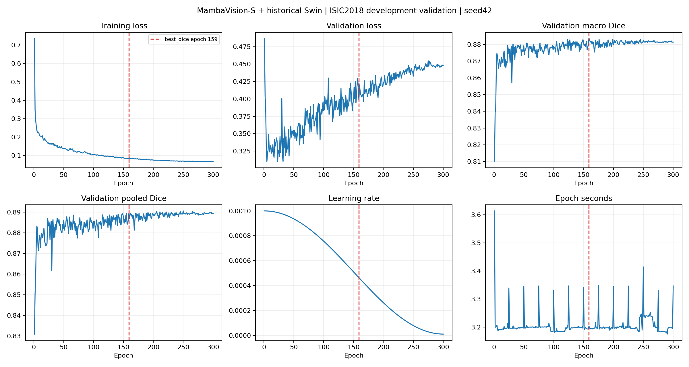
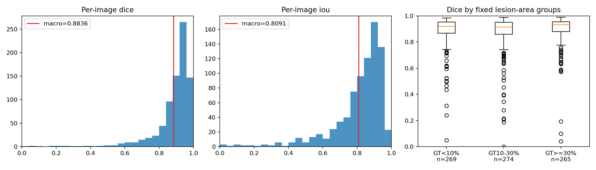

# MambaVision-S 冻结 Encoder：ISIC2018 seed42 实验报告

## 目的与结论范围

仅替换预训练视觉 Encoder，复用历史 Adapter、Swin Pixel Decoder、数据处理、损失和评价。单模型、单 seed42、300 完整 epochs / 9000 updates；1886/808 开发划分，非官方独立测试成绩。

主权重 best_dice 选中第 **159** 轮；验证 macro Dice **88.3598%**，pooled Dice **88.9288%**。
相对 DINOv3+Swin 的 macro Dice 差为 **-0.8249 个百分点**；相对 VMamba+Swin 为 **-0.1558 个百分点**。

## 官方来源与权重验收

- 模型：https://huggingface.co/nvidia/MambaVision-S-1K ，revision `e4f9ea93877fba6f1e2d231fd0f0a391368ad895`。
- 官方仓库：https://github.com/NVlabs/MambaVision ，检查 commit `7860a506b2eb844eaaae676f08461ce8c3c26f43`；实际执行固定 HF 官方特征接口，代码未修改。
- 权重 SHA256 `006af39903f2d88c5b455431d087d0fcbf5d5932114aef52542c0d2f0b1ec180`，与固定 revision 的远端 LFS 身份匹配。
- AutoModel loading_info 的 missing/unexpected/mismatched/error 均为空；进一步 strict load 并逐张量核对所有参数与缓冲区。
- 官方架构 depths=[3,3,7,5]、dim96，四级为 [B,96,64,64]、[B,192,32,32]、[B,384,16,16]、[B,768,8,8]。
- 递归 eval、requires_grad=False、no_grad；训练前后完整 Encoder state_dict 摘要一致，包含 BN 状态。未运行预训练分类头，保留并计入完整 Encoder 参数。
- 独立 smoke 完成两轮、通过新进程恢复与 optimizer/scheduler/Python/NumPy/CPU/CUDA RNG 核验，未载入正式训练。

## 架构与参数

原始 MambaVision 四级特征 → 历史 Conv1×1(bias=False)+GroupNorm8+GELU Adapter → 64通道金字塔 → 历史 SwinPixelDecoder → 1通道256×256 logits。每尺度2块、window8、shift0/4、heads4、MLP4，无新模块或额外loss。

| 部分 | 参数量 |
|---|---:|
| 完整官方 Encoder（冻结） | 50140584 |
| Adapter | 92672 |
| Swin Decoder（含输出层） | 407649 |
| 其中输出层（上项已包含） | 65 |
| 可训练总计 | 500321 |
| 完整模型 | 50640905 |

## 数据、环境与训练设置

数据清单与 stage1 原始全部图像/Mask/解码 SHA 逐项一致。1886训练、808验证，无过滤；原 ImageData 的 RGB bilinear resize、Mask nearest、ImageNet normalization 与 zero-padding 几何增强原样复用。H/V/rotation各p0.5；角度均匀0–360°；每轮42+epoch×100003控制顺序与几何。

AdamW lr0.001、wd0.01、betas(.9,.999)、eps1e-8；batch64，尾批30，无梯度累积，30更新/epoch；300轮无early stopping；Cosine T_max300、eta_min1e-5、无warmup，轮末step；BCE+逐图SoftDice(smooth1)，BF16 autocast/FP32 loss，clip1。

实际环境：`{"python": "3.11.8", "torch": "2.2.2+cu121", "cuda_runtime": "12.1", "cudnn": 8902, "gpu": "NVIDIA GeForce RTX 4090", "gpu_total_gib": 23.5184326171875, "timm": "1.0.22", "transformers": "4.44.2", "mamba-ssm": "1.2.2", "einops": "0.8.1", "numpy": "1.26.4", "scipy": "1.13.1", "Pillow": "10.3.0", "safetensors": "0.8.0", "selective_scan_cuda_path": "/home/featurize/referring_image_segmentation/stage14_mambavision_s_isic2018_seed42/runtime/selective_scan_cuda.cpython-311-x86_64-linux-gnu.so", "selective_scan_cuda_sha256": "0829e6a7d729adf47a5fdf24925238ea859f6395985a0db9fee8a7a8954ba929", "causal-conv1d": "not installed; official MambaVision uses torch conv1d and CUDA selective_scan_fn"}`。依赖仅安装在本阶段 runtime，保留历史代码与环境。

## 三种预先固定的 Checkpoint

| Selector | Epoch | Macro Dice | Pooled Dice | Macro IoU | Pooled IoU | BF1 | HD95 px |
|---|---:|---:|---:|---:|---:|---:|---:|
| best_dice | 159 | 0.883598 | 0.889288 | 0.809121 | 0.800647 | 0.333057 | 17.054988 |
| best_loss | 23 | 0.879367 | 0.886856 | 0.801965 | 0.796712 | 0.305305 | 17.562184 |
| last | 300 | 0.881386 | 0.889272 | 0.805005 | 0.800620 | 0.311821 | 16.615257 |

主表只用 best_dice，不按各指标重新挑轮。best_loss 按最低样本加权验证loss，last固定第300轮，精确并列取早。三种权重、恢复latest与逐像素输出均保留本地。

## 主权重完整指标

| 指标 | 数值 |
|---|---:|
| macro dice | 0.883597844 |
| macro iou | 0.809120917 |
| macro precision | 0.897508670 |
| macro recall | 0.905080981 |
| macro boundary_f1 | 0.333056676 |
| macro hd95_pixels | 17.054988262 |
| macro hd95_diagonal | 0.047108195 |
| pooled dice | 0.889288179 |
| pooled iou | 0.800647083 |
| pooled precision | 0.889023233 |
| pooled recall | 0.889553284 |
| Prec@IoU 0.5 | 0.944306931 |
| Prec@IoU 0.6 | 0.903465347 |
| Prec@IoU 0.7 | 0.841584158 |
| Prec@IoU 0.8 | 0.675742574 |
| Prec@IoU 0.9 | 0.303217822 |
| ISIC Threshold Jaccard 0.65 | 0.755886521 |

阈值probability>=0.5，256网格；所有空Mask规则、对角线0.5%边界容差及HD95定义直接复用 evaluation.py / stage1_visual.analyze.metrics。808张图TP/FP/FN/TN及Dice/IoU独立重算通过；完整逐图指标见per_image.csv。

## 与同条件历史基线比较

| Model | Macro Dice | Pooled Dice | Macro IoU | Pooled IoU | BF1 | HD95 px |
|---|---:|---:|---:|---:|---:|---:|
| DINOv3-S/16 + Swin | 0.891847 | 0.901134 | 0.819782 | 0.820058 | 0.327522 | 15.134619 |
| VMamba-Tiny + Swin | 0.885156 | 0.889607 | 0.810907 | 0.801164 | 0.340815 | 16.671474 |
| MambaVision-S + Swin | 0.883598 | 0.889288 | 0.809121 | 0.800647 | 0.333057 | 17.054988 |

dinov3_swin：改善/退步/并列图数 395/413/0；macro Dice差 -0.8249 个百分点，图像配对95%区间 [-1.3855, -0.2512] 个百分点。
核验历史概率SHA后统计：纠正 827728 像素、新增错误 1092657 像素、净减少错误 -264929 像素。

vmamba_swin：改善/退步/并列图数 393/415/0；macro Dice差 -0.1558 个百分点，图像配对95%区间 [-0.6631, 0.3255] 个百分点。
核验历史概率SHA后统计：纠正 875062 像素、新增错误 854697 像素、净减少错误 20365 像素。

不重跑历史模型，不比较不同Decoder或ISIC2016。预训练规模、数据、参数量均不同，本轮不作等容量或架构机制归因。

## 病灶面积与失败病例

| GT前景比例 | n | MambaVision Dice | DINO Dice | VMamba Dice | MambaVision BF1 |
|---|---:|---:|---:|---:|---:|
| lt_0.1 | 269 | 0.885800 | 0.880897 | 0.888935 | 0.512792 |
| 0.1_to_0.3 | 274 | 0.872272 | 0.889975 | 0.875060 | 0.262851 |
| ge_0.3 | 265 | 0.893074 | 0.904897 | 0.891759 | 0.223198 |

面积组预先固定为<10%、10–30%、>=30%，仅作描述。cases.json 保留相对DINO最大改善6例、最大退步6例、MambaVision最低Dice6例；同一图可出现在多个选择组。病例图片位于本地 examples/，不自动公开。不据无人工标签的误差图归因于毛发、反光或某种扫描机制。

## 效率与耗时

完整 uncached batch1 推理平均 **12.470 ms**，中位 12.389 ms；BF16，预热3/重复10、逐次CUDA同步，包含Encoder+Adapter+Swin+输出层，不含I/O及CPU预处理/后处理。独立进程峰值 allocated 0.331 GiB，增量 0.130 GiB。
训练平均 3.207 秒/epoch，峰值 8.325 GiB；完整正式训练进程活动耗时 983.263 秒（16.39分钟，含初始化/验证缓存/断点写入，不含预检和最终分析）。
Encoder、Decoder预检各自峰值与单批时间见preflight.json；无完整Selective Scan FLOPs支持，因此未将局部FLOPs当作完整模型FLOPs。历史速度来自历史设备/会话，仅背景参考。

## 学习曲线与局限

仅seed42，选模与分析均使用既有开发验证集；无患者级独立性认证和新外部测试。图像bootstrap不能估计患者相关性、训练随机性或消除开发选模偏差。BF16及CUDA算子不承诺逐位确定性。

## 是否值得微调

冻结基线尚未同时超过两个历史单分支，不建议仅凭模型规模就优先投入全量微调。若后续继续，先围绕失败面积组提出一个受控的部分解冻诊断。本轮不执行微调。即使冻结分数较低，也不能直接归因于Mamba扫描或Attention结构；后续另立协议并经用户确认，不把本轮改为全量微调。

数据和源码核验、300轮/9000更新、冻结状态、三选模规则与报告一致性由独立validate.py最终检查；只有全部通过，监督入口才写complete。

## 完成后的结果解读（不改变训练或选模）

总体结果：本次冻结 MambaVision-S 没有优于 DINOv3；与 VMamba 的 macro Dice 差较小，图像配对区间跨0，不把它描述成已证实的稳定差距。三个模型的预训练来源和总容量不同，不能据此归因于扫描或Attention。

相对 DINO 的分组差为：GT<10% **+0.490**、GT10–30% **-1.770**、GT>=30% **-1.182 个百分点**。因此平均下降并非所有面积组都下降；本轮较明显的短板在中、大面积组。这些是既定开发集描述，未认证病灶尺寸的因果效应。

相对 DINO，新增 FN 为 **337474**，FP 差为 **-72545**，总错误像素增加264929；漏检增加是本次计数层面主要差异。Boundary F1比DINO高0.553个百分点，但HD95高1.920像素，说明两类边界指标没有一致改善。不能据单一Boundary F1声称边界全面更好。

相对 VMamba，MambaVision 净减少20365个错误像素，却有略低的macro/pooled Dice。总错误数和前景归一化比值不同，逐图平均还给予每图相同权重，这种排序差异不代表指标计算错误；独立TP/FP/FN检查已通过。

失败分布：808张中 **105** 张Dice<0.8，**1** 张预测为空且Dice=0。编号193整灶漏检，DINO同图Dice为0.8319；编号275的MambaVision Dice为0.1931，而DINO约0.9769。相反，编号694相对DINO改善0.4844，但MambaVision本身Dice也只有0.7506，仍有误差。所有这些病例已在本地画册中保留，不只展示成功例。可见毛发等现象没有被当成经标注验证的失败原因。

学习曲线显示训练loss由0.7363降至0.0669，验证loss最低在第23轮，为0.3099，第300轮为0.4478；有过拟合迹象。主权重仍严格按最高macro Dice第159轮，不能事后改用最低loss或不同指标的最佳轮。

可能的解释仅作为待验证假设：监督ImageNet-1K预训练与DINOv3的预训练任务/数据规模不同；冻结表征对病灶目标的适配程度可能不同；相同轻量Decoder与不同Encoder特征的匹配程度也可能不同。当前只有Encoder对照，无法分离这些因素，更不能证明四方向扫描就能消除差距。

关于下一步SS2D：这是用户在本轮训练期间提出的候选，未实施或追加训练。VMamba的SS2D使用四条扫描路线（https://github.com/MzeroMiko/VMamba）；MambaVision后两级包含窗口内的MambaVisionMixer及Attention（https://github.com/NVlabs/MambaVision）。应区分“只修改SSM扫描路线”与“整块替换为完整SS2D”：前者可考虑共享兼容权重并保留窗口/非SSM分支/Attention以减少变量；后者可能新增不兼容参数，必须核验权重迁移，不能将随机新增模块冻结后当作完整官方预训练。若需要微调，对照原模型也须使用相同微调范围；不能把扫描与解冻两项收益混为一谈。无论选择哪种，均另立协议，本轮保持原始官方基线。
