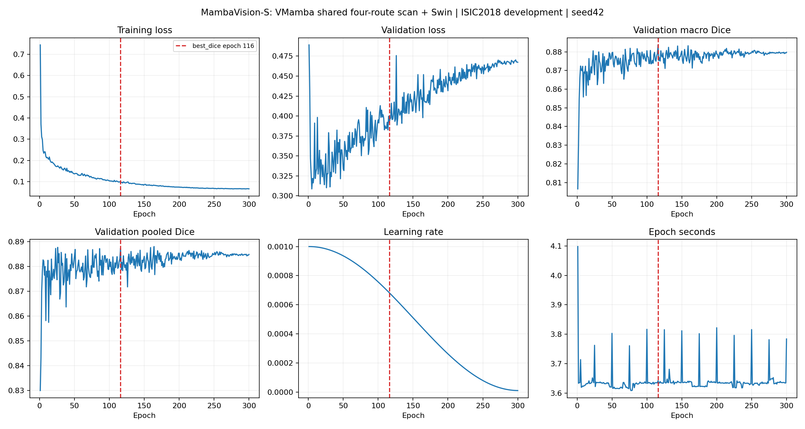
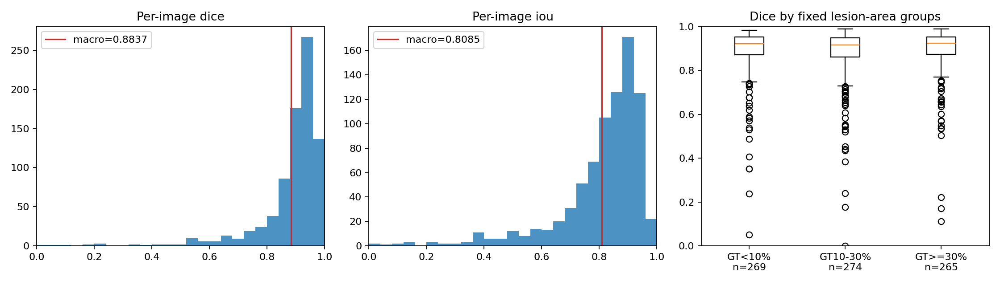

# MambaVision-S + VMamba四路扫描：ISIC2018 seed42 对照

## 目的与结论范围

仅将MambaVision-S的7个SSM分支改为VMamba官方四路扫描/合并，四方向共享原预训练参数并取均值；这不是整块VMamba SS2D模块替换。保留窗口、CNN、Attention、非SSM旁路及历史Adapter/Swin/训练评价。单模型、单 seed42、300 完整 epochs / 9000 updates；1886/808 开发划分，非官方独立测试成绩。

主权重 best_dice 选中第 **116** 轮；验证 macro Dice **88.3712%**，pooled Dice **88.7314%**。
相对原始MambaVision-S的macro Dice差为 **+0.0114 个百分点**。
相对 DINOv3+Swin 的 macro Dice 差为 **-0.8134 个百分点**；相对 VMamba+Swin 为 **-0.1444 个百分点**。

## 官方来源与权重验收

- 模型：https://huggingface.co/nvidia/MambaVision-S-1K ，revision `e4f9ea93877fba6f1e2d231fd0f0a391368ad895`。
- 官方仓库：https://github.com/NVlabs/MambaVision ，检查 commit `7860a506b2eb844eaaae676f08461ce8c3c26f43`；原HF源码未修改；本阶段包装器替换7个SSM扫描前向，详见models.py与routing_preflight.json。
- 权重 SHA256 `006af39903f2d88c5b455431d087d0fcbf5d5932114aef52542c0d2f0b1ec180`，与固定 revision 的远端 LFS 身份匹配。
- AutoModel loading_info 的 missing/unexpected/mismatched/error 均为空；进一步 strict load 并逐张量核对所有参数与缓冲区。
- 官方架构 depths=[3,3,7,5]、dim96，四级为 [B,96,64,64]、[B,192,32,32]、[B,384,16,16]、[B,768,8,8]。
- 递归 eval、requires_grad=False、no_grad；训练前后完整 Encoder state_dict 摘要一致，包含 BN 状态。未运行预训练分类头，保留并计入完整 Encoder 参数。
- 独立 smoke 完成两轮、通过新进程恢复与 optimizer/scheduler/Python/NumPy/CPU/CUDA RNG 核验，未载入正式训练。

## 架构与参数

共享预训练参数的四路扫描 MambaVision 四级特征 → 历史 Conv1×1(bias=False)+GroupNorm8+GELU Adapter → 64通道金字塔 → 历史 SwinPixelDecoder → 1通道256×256 logits。每尺度2块、window8、shift0/4、heads4、MLP4，没有新增可学习参数或额外loss；只新增固定四路扫描与均值合并。

| 部分 | 参数量 |
|---|---:|
| 四路Encoder（与原始参数量相同，冻结） | 50140584 |
| Adapter | 92672 |
| Swin Decoder（含输出层） | 407649 |
| 其中输出层（上项已包含） | 65 |
| 可训练总计 | 500321 |
| 完整模型 | 50640905 |

## 数据、环境与训练设置

数据清单与 stage1 原始全部图像/Mask/解码 SHA 逐项一致。1886训练、808验证，无过滤；原 ImageData 的 RGB bilinear resize、Mask nearest、ImageNet normalization 与 zero-padding 几何增强原样复用。H/V/rotation各p0.5；角度均匀0–360°；每轮42+epoch×100003控制顺序与几何。

AdamW lr0.001、wd0.01、betas(.9,.999)、eps1e-8；batch64，尾批30，无梯度累积，30更新/epoch；300轮无early stopping；Cosine T_max300、eta_min1e-5、无warmup，轮末step；BCE+逐图SoftDice(smooth1)，BF16 autocast/FP32 loss，clip1。

实际环境：`{"python": "3.11.8", "torch": "2.2.2+cu121", "cuda_runtime": "12.1", "cudnn": 8902, "gpu": "NVIDIA GeForce RTX 4090", "gpu_total_gib": 23.5184326171875, "timm": "1.0.22", "transformers": "4.44.2", "mamba-ssm": "1.2.2", "einops": "0.8.1", "numpy": "1.26.4", "scipy": "1.13.1", "Pillow": "10.3.0", "safetensors": "0.8.0", "selective_scan_cuda_path": "/home/featurize/referring_image_segmentation/stage15_mambavision_ss2d_scan_seed42/runtime/selective_scan_cuda.cpython-311-x86_64-linux-gnu.so", "selective_scan_cuda_sha256": "0829e6a7d729adf47a5fdf24925238ea859f6395985a0db9fee8a7a8954ba929", "causal-conv1d": "not installed; official MambaVision uses torch conv1d and CUDA selective_scan_fn"}`。只读共享stage14的runtime与official资产，没有额外安装或修改历史依赖。

## 三种预先固定的 Checkpoint

| Selector | Epoch | Macro Dice | Pooled Dice | Macro IoU | Pooled IoU | BF1 | HD95 px |
|---|---:|---:|---:|---:|---:|---:|---:|
| best_dice | 116 | 0.883712 | 0.887314 | 0.808456 | 0.797453 | 0.323458 | 17.254635 |
| best_loss | 5 | 0.872411 | 0.882595 | 0.793000 | 0.789862 | 0.318564 | 18.745528 |
| last | 300 | 0.879752 | 0.884786 | 0.802011 | 0.793377 | 0.307099 | 17.185664 |

主表只用 best_dice，不按各指标重新挑轮。best_loss 按最低样本加权验证loss，last固定第300轮，精确并列取早。三种权重、恢复latest与逐像素输出均保留本地。

## 主权重完整指标

| 指标 | 数值 |
|---|---:|
| macro dice | 0.883712174 |
| macro iou | 0.808455850 |
| macro precision | 0.889442899 |
| macro recall | 0.911616052 |
| macro boundary_f1 | 0.323457566 |
| macro hd95_pixels | 17.254634510 |
| macro hd95_diagonal | 0.047659645 |
| pooled dice | 0.887314446 |
| pooled iou | 0.797453011 |
| pooled precision | 0.886549822 |
| pooled recall | 0.888080390 |
| Prec@IoU 0.5 | 0.941831683 |
| Prec@IoU 0.6 | 0.907178218 |
| Prec@IoU 0.7 | 0.847772277 |
| Prec@IoU 0.8 | 0.679455446 |
| Prec@IoU 0.9 | 0.301980198 |
| ISIC Threshold Jaccard 0.65 | 0.756481402 |

阈值probability>=0.5，256网格；所有空Mask规则、对角线0.5%边界容差及HD95定义直接复用 evaluation.py / stage1_visual.analyze.metrics。808张图TP/FP/FN/TN及Dice/IoU独立重算通过；完整逐图指标见per_image.csv。

## 与同条件历史基线比较

| Model | Macro Dice | Pooled Dice | Macro IoU | Pooled IoU | BF1 | HD95 px |
|---|---:|---:|---:|---:|---:|---:|
| DINOv3-S/16 + Swin | 0.891847 | 0.901134 | 0.819782 | 0.820058 | 0.327522 | 15.134619 |
| VMamba-Tiny + Swin | 0.885156 | 0.889607 | 0.810907 | 0.801164 | 0.340815 | 16.671474 |
| Original MambaVision-S + Swin | 0.883598 | 0.889288 | 0.809121 | 0.800647 | 0.333057 | 17.054988 |
| MambaVision-S four-route + Swin | 0.883712 | 0.887314 | 0.808456 | 0.797453 | 0.323458 | 17.254635 |

mambavision_original：改善/退步/并列图数 370/436/2；macro Dice差 +0.0114 个百分点，图像配对95%区间 [-0.3011, 0.3409] 个百分点。
核验历史概率SHA后统计：纠正 598677 像素、新增错误 651215 像素、净减少错误 -52538 像素。

dinov3_swin：改善/退步/并列图数 391/417/0；macro Dice差 -0.8134 个百分点，图像配对95%区间 [-1.3878, -0.2452] 个百分点。
核验历史概率SHA后统计：纠正 826236 像素、新增错误 1143703 像素、净减少错误 -317467 像素。

vmamba_swin：改善/退步/并列图数 395/413/0；macro Dice差 -0.1444 个百分点，图像配对95%区间 [-0.6683, 0.3568] 个百分点。
核验历史概率SHA后统计：纠正 898704 像素、新增错误 930877 像素、净减少错误 -32173 像素。

原始MambaVision主对照的预训练状态、容量、可训练初值和训练设置完全相同，只改变扫描/均值合并。DINO/VMamba是不同预训练来源及容量的背景参考，不据其差异作架构机制归因。不重跑历史模型，不比较ISIC2016或不同Decoder。

## 病灶面积与失败病例

| GT前景比例 | n | 四路Dice | 原始MambaVision Dice | DINO Dice | VMamba Dice | 四路BF1 |
|---|---:|---:|---:|---:|---:|---:|
| lt_0.1 | 269 | 0.886140 | 0.885800 | 0.880897 | 0.888935 | 0.495369 |
| 0.1_to_0.3 | 274 | 0.875912 | 0.872272 | 0.889975 | 0.875060 | 0.258857 |
| ge_0.3 | 265 | 0.889313 | 0.893074 | 0.904897 | 0.891759 | 0.215746 |

面积组预先固定为<10%、10–30%、>=30%，仅作描述。cases.json 保留相对原始MambaVision最大改善6例、最大退步6例、MambaVision最低Dice6例；同一图可出现在多个选择组。病例图片位于本地 examples/，不自动公开。不据无人工标签的误差图归因于毛发、反光或某种扫描机制。

## 效率与耗时

完整 uncached batch1 推理平均 **14.113 ms**，中位 14.023 ms；BF16，预热3/重复10、逐次CUDA同步，包含Encoder+Adapter+Swin+输出层，不含I/O及CPU预处理/后处理。独立进程峰值 allocated 0.331 GiB，增量 0.130 GiB。
训练平均 3.640 秒/epoch，峰值 8.325 GiB；完整正式训练进程活动耗时 1113.332 秒（18.56分钟，含初始化/验证缓存/断点写入，不含预检和最终分析）。
Encoder、Decoder预检各自峰值与单批时间见preflight.json；无完整Selective Scan FLOPs支持，因此未将局部FLOPs当作完整模型FLOPs。历史速度来自历史设备/会话，仅背景参考。

## 学习曲线与局限

仅seed42，选模与分析均使用既有开发验证集；无患者级独立性认证和新外部测试。图像bootstrap不能估计患者相关性、训练随机性或消除开发选模偏差。BF16及CUDA算子不承诺逐位确定性。

## 是否值得微调

四路版本仅macro Dice微高0.0114个百分点、图像区间跨0，pooled Dice及平均边界指标下降；当前没有明确实际优势，不据此选为新基线。本轮不执行微调。即使冻结分数较低，也不能直接归因于Mamba扫描或Attention结构；后续另立协议并经用户确认，不把本轮改为全量微调。

数据和源码核验、300轮/9000更新、冻结状态、三选模规则与报告一致性由独立validate.py最终检查；只有全部通过，监督入口才写complete。

## 完成后的综合判断

主权重macro Dice差为+0.0114个百分点，图像配对95%区间[-0.3011, 0.3409]个百分点；单seed不能据此声称稳定改进。pooled Dice下降0.1974个百分点，Boundary F1下降0.9599个百分点，HD95增加0.1996px。

相对原始模型，纠正598677个错误像素，同时新增651215个，净增加52538个错误。FP增加33553，FN增加18985，不支持错误总体减少。

既定面积组Dice差为：GT<10% +0.034、GT10–30% +0.364、GT>=30% -0.376个百分点。中等面积有改善，大面积下降；均值几乎相同掩盖了分组取舍，不能据此作面积的因果归因。

完整单图推理14.11ms，原始基线此前12.47ms，两次独立会话仅作描述；此次未体现精度与效率的整体优势。代码、权重、数据、冻结状态和全指标复核通过，当前差异不是通过少跑epoch或改变batch获得。

结论只针对本轮：四方向共享原单路预训练参数、保持窗口、四路均值、Encoder冻结。这不是完整VMamba SS2D模块替换，也没有用完整SS2D的预训练或微调；不能把本结果写成“VMamba/SS2D无效”。完整模块替换及匹配微调需要另立实验，本轮没有自动追加。
