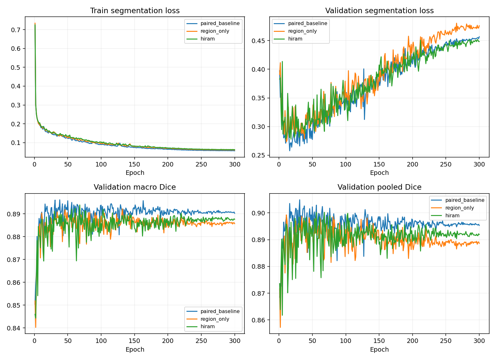

# HiRAM 迁移：ISIC2018 seed 42

全部模型为 300 epochs / 9000 updates；开发验证集不是独立测试。

| 模型 | 最佳轮 | Macro Dice | Pooled Dice | Macro IoU | Boundary F1 | HD95 px |
|---|---:|---:|---:|---:|---:|---:|
| paired_baseline | 38 | 0.896114 | 0.902595 | 0.825968 | 0.351163 | 14.762 |
| region_only | 132 | 0.892150 | 0.898088 | 0.821363 | 0.376433 | 15.618 |
| hiram | 68 | 0.893846 | 0.900231 | 0.823122 | 0.352932 | 15.212 |

region_only 相对本机配对基线 Macro Dice 差 -0.396 个百分点；逐图配对 bootstrap 95% 区间 [-0.008008339063052887, 3.924022420910198e-05]（小数尺度）。纠正 663879、新增 788128 个错误像素。

hiram 相对本机配对基线 Macro Dice 差 -0.227 个百分点；逐图配对 bootstrap 95% 区间 [-0.005877197080881675, 0.0010670700342093342]（小数尺度）。纠正 556304、新增 615423 个错误像素。

HiRAM 相对仅区域监督的 Macro Dice 差 +0.170 个百分点。

历史 stage4 fusion_swin Macro Dice 为 0.895492；本机历史初始摘要无法复现，已重新训练配对基线。
16×16 区域标签的双线性缩小会使 11 张训练图和 1 张验证图的边界标签消失。
新增的区域监督、SSM、跨分支交互和参数量共同变化；B 与 C 比较仍不能完全排除容量贡献。
单种子且反复使用开发集，不能宣称稳定提升或外部泛化。各项完整指标和推理速度见 summary.json。

