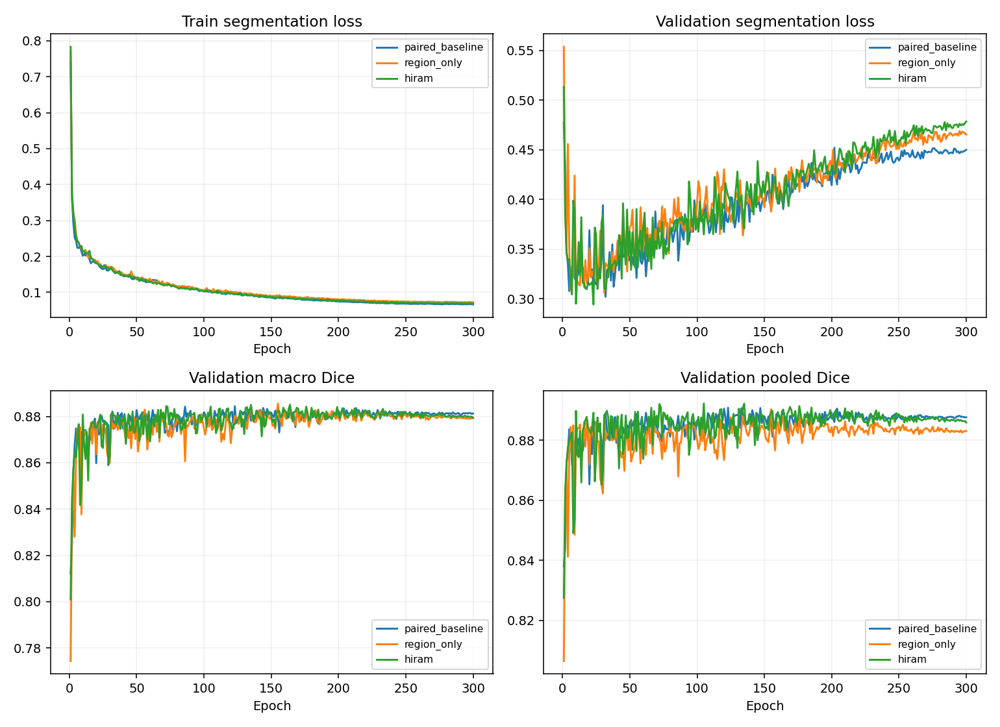

# MambaVision-S Decoder 内 HiRAM：ISIC2018 seed 42

全部模型为 300 epochs / 9000 updates；开发验证集不是独立测试。

| 模型 | 最佳轮 | Macro Dice | Pooled Dice | Macro IoU | Boundary F1 | HD95 px |
|---|---:|---:|---:|---:|---:|---:|
| paired_baseline | 123 | 0.884398 | 0.890883 | 0.809268 | 0.328409 | 16.535 |
| region_only | 155 | 0.885615 | 0.890371 | 0.811294 | 0.340342 | 16.385 |
| hiram | 164 | 0.885115 | 0.890277 | 0.810657 | 0.331744 | 16.394 |

region_only 相对本机配对基线 Macro Dice 差 +0.122 个百分点；逐图配对 bootstrap 95% 区间 [-0.0025142180699805356, 0.0051307847940037015]（小数尺度）。纠正 701526、新增 685113 个错误像素。

hiram 相对本机配对基线 Macro Dice 差 +0.072 个百分点；逐图配对 bootstrap 95% 区间 [-0.0032908647662133416, 0.004975666627894596]（小数尺度）。纠正 742932、新增 806653 个错误像素。

HiRAM 相对仅区域监督的 Macro Dice 差 -0.050 个百分点。

历史 stage14 MambaVision-S + Swin Macro Dice 为 0.883598；本机重新训练配对基线。
32×32 区域标签全部有边界；16×16 标签有 11 张训练图和 1 张验证图边界消失。此观察不保证 32×32 性能更好。
新增的区域监督、SSM、跨分支交互和参数量共同变化；B 与 C 比较仍不能完全排除容量贡献。
单种子且反复使用开发集，不能宣称稳定提升或外部泛化。各项完整指标和推理速度见 summary.json。

