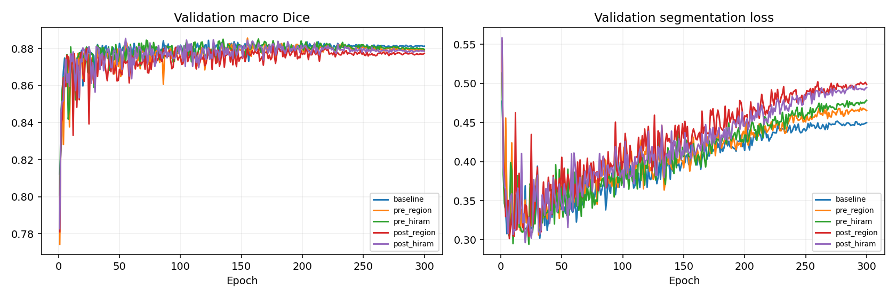

# HiRAM 后置 Swin32：ISIC2018 seed 42

历史三组和新两组均为 300 epochs、9000 更新；开发验证集不等于独立测试集。

| 模型 | 最佳轮 | Macro Dice | Pooled Dice | Macro IoU | Boundary F1 | HD95 px | 完整推理 ms |
|---|---:|---:|---:|---:|---:|---:|---:|
| baseline | 123 | 0.884398 | 0.890883 | 0.809268 | 0.328409 | 16.535 | 20.11 |
| pre_region | 155 | 0.885615 | 0.890371 | 0.811294 | 0.340342 | 16.385 | 20.01 |
| pre_hiram | 164 | 0.885115 | 0.890277 | 0.810657 | 0.331744 | 16.394 | 28.21 |
| post_region | 176 | 0.882038 | 0.889328 | 0.807483 | 0.328794 | 16.790 | 19.93 |
| post_hiram | 55 | 0.885466 | 0.893134 | 0.811206 | 0.320410 | 16.242 | 28.33 |

post_hiram_minus_pre_hiram: Macro Dice +0.035 个百分点；逐图 bootstrap 95% 区间 [-0.0031116797537028163, 0.003828971792253053]（小数尺度）；纠正 758007、新增 655811 个错误像素。

post_hiram_minus_post_region: Macro Dice +0.343 个百分点；逐图 bootstrap 95% 区间 [5.3653368118027607e-05, 0.006957827612647983]（小数尺度）；纠正 653468、新增 585786 个错误像素。

post_region_minus_pre_region: Macro Dice -0.358 个百分点；逐图 bootstrap 95% 区间 [-0.007120492833275124, 5.262364279534101e-05]（小数尺度）；纠正 596618、新增 642238 个错误像素。

post_hiram_minus_baseline: Macro Dice +0.107 个百分点；逐图 bootstrap 95% 区间 [-0.002665216443067431, 0.004694028211539451]（小数尺度）；纠正 703099、新增 664624 个错误像素。

两种位置的第一路输入及区域监督输入也不同，不能把差异归结为纯位置效应。单 seed 且使用开发验证集选模，不能据此宣称跨种子稳定或外部泛化。

