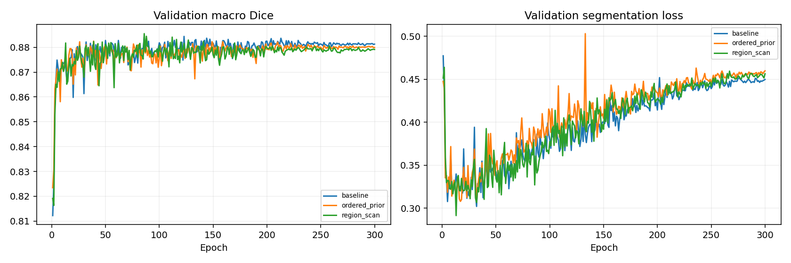

# MambaVision 编码器内部区域扫描：ISIC2018 seed 42

历史基线和两组新模型均为 300 epochs、9000 更新；开发验证集不等于独立测试集。

| 模型 | 最佳轮 | Macro Dice | Pooled Dice | Macro IoU | Boundary F1 | HD95 px | 完整推理 ms |
|---|---:|---:|---:|---:|---:|---:|---:|
| baseline | 123 | 0.884398 | 0.890883 | 0.809268 | 0.328409 | 16.535 | 20.11 |
| ordered_prior | 39 | 0.882501 | 0.887271 | 0.806640 | 0.328197 | 17.015 | 27.56 |
| region_scan | 86 | 0.885507 | 0.892628 | 0.810082 | 0.312005 | 16.348 | 27.71 |

region_scan_minus_ordered_prior: Macro Dice +0.301 个百分点；逐图 bootstrap 95% 区间 [-0.0008177517834297953, 0.006920516760446192]（小数尺度）；纠正 708566、新增 588142 个错误像素。

ordered_prior_minus_baseline: Macro Dice -0.190 个百分点；逐图 bootstrap 95% 区间 [-0.005368141599020542, 0.0016464039822040334]（小数尺度）；纠正 609172、新增 690455 个错误像素。

region_scan_minus_baseline: Macro Dice +0.111 个百分点；逐图 bootstrap 95% 区间 [-0.002038346416064125, 0.004412216150882167]（小数尺度）；纠正 606040、新增 566899 个错误像素。

区域组与原序组的主比较同时改变分组、排序与SSM状态重置；两者都单独扫描填充，与原始基线的填充行为不同。单 seed 且使用开发验证集选模，不能据此宣称跨种子稳定或外部泛化。

