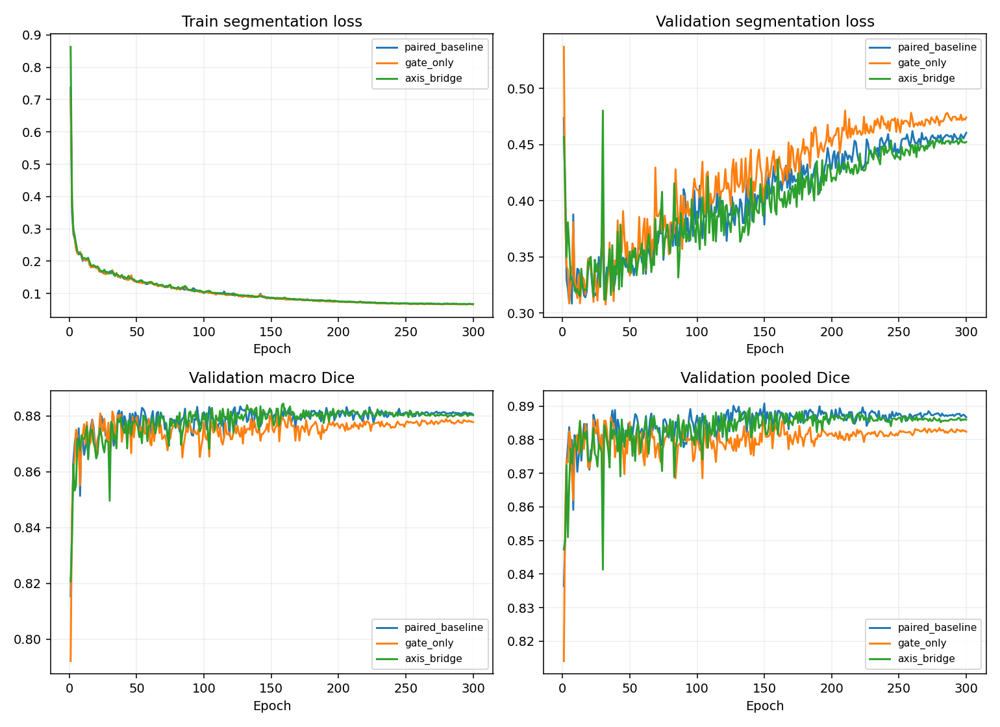

# MambaVision-S + AXIS-Bridge：ISIC2018 seed 42

全部模型为 300 epochs / 9000 updates；开发验证集不是独立测试。

| 模型 | 最佳轮 | Macro Dice | Pooled Dice | Macro IoU | Boundary F1 | HD95 px |
|---|---:|---:|---:|---:|---:|---:|
| paired_baseline | 127 | 0.883380 | 0.890123 | 0.809551 | 0.337525 | 16.625 |
| gate_only | 32 | 0.881535 | 0.885695 | 0.805248 | 0.324437 | 16.948 |
| axis_bridge | 159 | 0.884398 | 0.886791 | 0.810539 | 0.353797 | 16.578 |

gate_only 相对本机配对基线 Macro Dice 差 -0.185 个百分点；逐图配对 bootstrap 95% 区间 [-0.006199019683754333, 0.002584131517818688]（小数尺度）。纠正 623239、新增 782505 个错误像素。

axis_bridge 相对本机配对基线 Macro Dice 差 +0.102 个百分点；逐图配对 bootstrap 95% 区间 [-0.0027677518374512357, 0.004877054599540351]（小数尺度）。纠正 611172、新增 697386 个错误像素。

完整 AXIS 相对仅门控的 Macro Dice 差 +0.286 个百分点。

历史 stage17 MambaVision-S + Swin Macro Dice 为 0.884398；本次采用相同 BF16 精度，但解码器初始化哈希不同，因此以本次配对基线作为主要比较。
仅在 32×32 跳接中使用原始 AXIS-Bridge，并非复现完整 HEDS-Net。
AXIS 增加少量可训练参数；门控对照帮助区分坐标注意力的额外作用，但不构成完整等参数控制。
单种子且反复使用开发集，不能宣称稳定提升或外部泛化。各项完整指标和推理速度见 summary.json。

