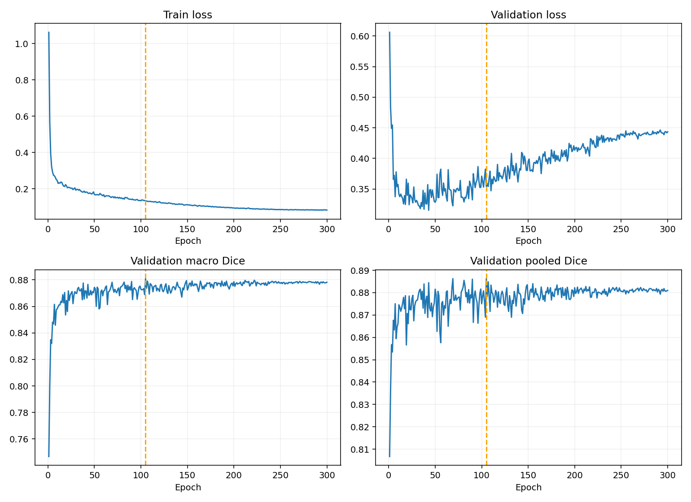

# MambaVision-S + 适配版 SegMAN Decoder：ISIC2018 seed 42

两组均为 BF16、300 epochs、9000 updates；验证集为用于选模的开发集。

| 模型 | 最佳轮 | Macro Dice | Pooled Dice | Macro IoU | Boundary F1 | HD95 px |
|---|---:|---:|---:|---:|---:|---:|
| segman | 105 | 0.880943 | 0.886227 | 0.805228 | 0.324950 | 16.872 |
| swin | 127 | 0.883380 | 0.890123 | 0.809551 | 0.337525 | 16.625 |

SegMAN 适配版相对同机 Swin 的 Macro Dice 差 -0.244 个百分点；逐图配对 bootstrap 95% 区间 [-0.007120914849236697, 0.0023411730240974864]（小数尺度）。
纠正 833746 个像素，新增 977674 个错误像素。

这是框架与扫描内核的适配版，未与不可用的官方 oflex kernel 逐项数值比对，不称完整官方复现。
SegMAN decoder 使用 SyncBN 与约 556 万可训练参数，而 Swin probe 约 50 万；不能把差异仅归因于扫描或视作等参数实验。
其原始 decoder 路径不使用 c1；输入、目标损失和数据处理保持相同，模型差异不止一个内部子模块。
单种子且反复使用开发集，不能宣称稳定或外部泛化；完整指标、逐图分数和耗时见 summary.json。

