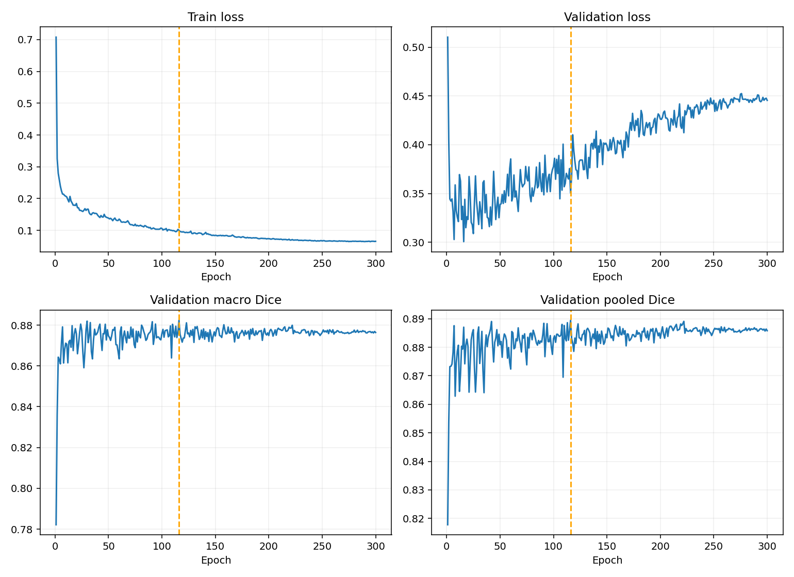

# MambaVision-S + 适配版 HGM BMD Decoder：ISIC2018 seed 42

两组均为 BF16、300 epochs、9000 updates；验证集为用于选模的开发集。

| 模型 | 最佳轮 | Macro Dice | Pooled Dice | Macro IoU | Boundary F1 | HD95 px |
|---|---:|---:|---:|---:|---:|---:|
| hgm_bmd | 116 | 0.882394 | 0.889487 | 0.807695 | 0.320080 | 17.165 |
| swin | 127 | 0.883380 | 0.890123 | 0.809551 | 0.337525 | 16.625 |

HGM BMD 适配版相对同机 Swin 的 Macro Dice 差 -0.099 个百分点；逐图配对 bootstrap 95% 区间 [-0.00563858362079827, 0.003900018817551586]（小数尺度）。
纠正 702624 个像素，新增 749066 个错误像素。

这是部分 Swin 与 HGM BMD 的适配版，使用本地 Mamba 1.2.2，不能称为完整 HGM 复现。
HGM BMD 适配版约 105 万可训练参数，而 Swin probe 约 50 万；拓扑与归一化不同，不能把差异仅归因于扫描或视作等参数实验。
原 HGM 的 BDFM、图网络并未迁移；适配版改变 Decoder 的多个内部组件。
单种子且反复使用开发集，不能宣称稳定或外部泛化；完整指标、逐图分数和耗时见 summary.json。

