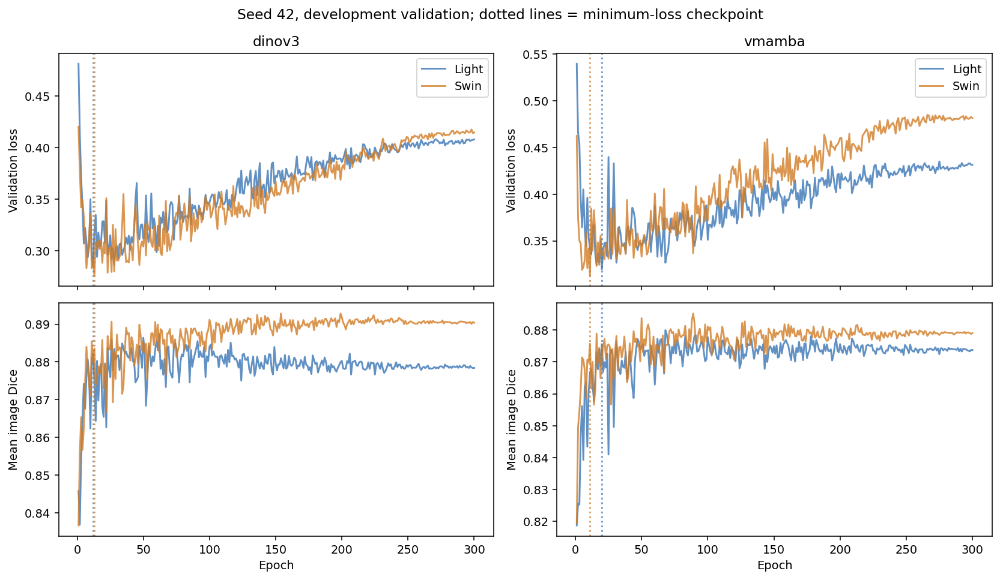
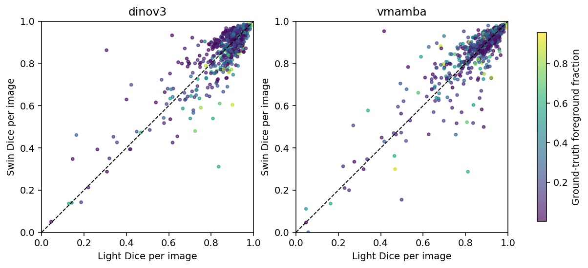

# Decoder 对照诊断图

所有图基于 seed 42 和已有开发验证集。

## 按目标面积分组

面积定义为 GT 前景像素占 256×256 的比例；固定分组 <10%、10–30%、>=30%。探索性分组不用于选模。

| Group | N | Model | Mean Dice | mIoU | Boundary F1 | HD95 px |
|---|---:|---|---:|---:|---:|---:|
| small (<10%) | 269 | dinov3_light | 0.862945 | 0.776515 | 0.374497 | 10.650 |
| small (<10%) | 269 | vmamba_light | 0.877729 | 0.799499 | 0.468210 | 9.946 |
| small (<10%) | 269 | dinov3_swin | 0.878904 | 0.799835 | 0.468520 | 8.494 |
| small (<10%) | 269 | vmamba_swin | 0.873643 | 0.792441 | 0.460157 | 11.487 |
| small (<10%) | 269 | mean_light | 0.880524 | 0.801593 | 0.437722 | 9.045 |
| small (<10%) | 269 | mean_swin | 0.886532 | 0.810911 | 0.487010 | 8.609 |
| medium (10-30%) | 274 | dinov3_light | 0.880723 | 0.804640 | 0.228993 | 15.970 |
| medium (10-30%) | 274 | vmamba_light | 0.867093 | 0.786678 | 0.254621 | 18.486 |
| medium (10-30%) | 274 | dinov3_swin | 0.885477 | 0.812960 | 0.309645 | 15.411 |
| medium (10-30%) | 274 | vmamba_swin | 0.867682 | 0.788047 | 0.251568 | 18.689 |
| medium (10-30%) | 274 | mean_light | 0.879569 | 0.804333 | 0.252275 | 16.120 |
| medium (10-30%) | 274 | mean_swin | 0.881215 | 0.807764 | 0.283002 | 16.346 |
| large (>=30%) | 265 | dinov3_light | 0.903238 | 0.835317 | 0.225231 | 21.743 |
| large (>=30%) | 265 | vmamba_light | 0.882113 | 0.803915 | 0.187761 | 25.872 |
| large (>=30%) | 265 | dinov3_swin | 0.886352 | 0.813758 | 0.260979 | 24.042 |
| large (>=30%) | 265 | vmamba_swin | 0.886206 | 0.811419 | 0.216386 | 25.352 |
| large (>=30%) | 265 | mean_light | 0.901291 | 0.831782 | 0.208335 | 21.991 |
| large (>=30%) | 265 | mean_swin | 0.895746 | 0.826647 | 0.258462 | 22.510 |

## 改善/退步最大的病例

下图有意选择 Dice 改善最大的两张与退步最大的两张，不能代表随机样本或整体分布。未人工标注毛发、反光等原因。

