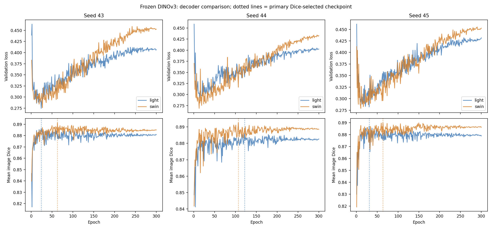

# 第三轮：三 seed 与选模规则对照

DINOv3-S/16 冻结编码器；Light vs Swin；seeds 43/44/45；各 300 epochs / 9000 updates。
1886/808 旧开发划分，256×256，固定概率阈值 .5。不是独立测试。± 为三个训练 seeds 的样本标准差（ddof=1）。

## 主结果：按 mean Dice 选模

| Decoder | Mean Dice | Pooled Dice | mIoU | oIoU | Boundary F1 | HD95 px |
|---|---:|---:|---:|---:|---:|---:|
| light | 0.886314 ± 0.000614 | 0.897020 ± 0.002504 | 0.811351 ± 0.000107 | 0.813276 ± 0.004114 | 0.301777 ± 0.015373 | 15.817114 ± 0.317335 |
| swin | 0.891227 ± 0.001321 | 0.899283 ± 0.000930 | 0.819644 ± 0.001311 | 0.816999 ± 0.001536 | 0.340208 ± 0.009175 | 15.178963 ± 0.099409 |

## 各 seed 的主结果

| Seed | Decoder | Selected epoch | Mean Dice | Pooled Dice | mIoU | oIoU | Boundary F1 | HD95 px |
|---:|---|---:|---:|---:|---:|---:|---:|---:|
| 43 | light | 24 | 0.886112 | 0.899314 | 0.811234 | 0.817048 | 0.290942 | 15.495218 |
| 43 | swin | 63 | 0.891294 | 0.898712 | 0.819122 | 0.816055 | 0.329662 | 15.142424 |
| 44 | light | 122 | 0.885827 | 0.894349 | 0.811374 | 0.808888 | 0.319371 | 16.129682 |
| 44 | swin | 107 | 0.892513 | 0.900357 | 0.821136 | 0.818772 | 0.346357 | 15.291470 |
| 45 | light | 31 | 0.887003 | 0.897398 | 0.811444 | 0.813891 | 0.295017 | 15.826441 |
| 45 | swin | 64 | 0.889873 | 0.898782 | 0.818675 | 0.816170 | 0.344605 | 15.102993 |

## 主结果的 Swin−Light 配对差

| Metric | Seed 43 | Seed 44 | Seed 45 | Mean delta ± SD |
|---|---:|---:|---:|---:|
| Mean Dice | +0.005182 | +0.006685 | +0.002870 | +0.004912 ± 0.001922 |
| Pooled Dice | -0.000602 | +0.006008 | +0.001384 | +0.002263 ± 0.003392 |
| mIoU | +0.007888 | +0.009762 | +0.007231 | +0.008294 ± 0.001314 |
| oIoU | -0.000993 | +0.009883 | +0.002280 | +0.003723 ± 0.005580 |
| Boundary F1 | +0.038720 | +0.026985 | +0.049588 | +0.038431 ± 0.011304 |
| HD95 px | -0.352794 | -0.838212 | -0.723448 | -0.638151 ± 0.253701 |

HD95 的负差表示改善。只用 3 个 seeds 的方向与离散程度描述训练随机性，不作患者级或独立测试显著性推断。

## 次要选模对照

### best_loss

| Decoder | Mean Dice | Pooled Dice | mIoU | oIoU | Boundary F1 | HD95 px |
|---|---:|---:|---:|---:|---:|---:|
| light | 0.885055 ± 0.002640 | 0.895648 ± 0.004787 | 0.809689 ± 0.002859 | 0.811039 ± 0.007834 | 0.295014 ± 0.004071 | 15.982716 ± 0.581600 |
| swin | 0.887729 ± 0.000735 | 0.896917 ± 0.001614 | 0.813771 ± 0.000703 | 0.813104 ± 0.002654 | 0.323625 ± 0.013087 | 15.902395 ± 0.272221 |

### last

| Decoder | Mean Dice | Pooled Dice | mIoU | oIoU | Boundary F1 | HD95 px |
|---|---:|---:|---:|---:|---:|---:|
| light | 0.880779 ± 0.001913 | 0.886487 ± 0.003856 | 0.803887 ± 0.003115 | 0.796132 ± 0.006208 | 0.314112 ± 0.010767 | 16.867913 ± 0.101713 |
| swin | 0.886541 ± 0.001830 | 0.892980 ± 0.002123 | 0.811255 ± 0.002616 | 0.806656 ± 0.003468 | 0.313238 ± 0.008587 | 15.945624 ± 0.421548 |

## 完整补充指标

| Criterion | Decoder | Mean Precision | Mean Recall | Pooled Precision | Pooled Recall | P@0.5 | P@0.6 | P@0.7 | P@0.8 | P@0.9 | Threshold Jaccard | Normalized HD95 |
|---|---|---:|---:|---:|---:|---:|---:|---:|---:|---:|---:|---:|
| best_dice | light | 0.886665 ± 0.002279 | 0.918823 ± 0.002556 | 0.885437 ± 0.000949 | 0.908923 ± 0.005534 | 0.949257 ± 0.005395 | 0.912129 ± 0.009344 | 0.850660 ± 0.011763 | 0.687706 ± 0.005002 | 0.281766 ± 0.031537 | 0.759643 ± 0.005372 | 0.043689 ± 0.000877 |
| best_dice | swin | 0.903218 ± 0.007901 | 0.910687 ± 0.007378 | 0.892010 ± 0.007935 | 0.906779 ± 0.008725 | 0.949670 ± 0.006816 | 0.922030 ± 0.001238 | 0.862624 ± 0.002475 | 0.702558 ± 0.002858 | 0.330033 ± 0.017949 | 0.777097 ± 0.003406 | 0.041926 ± 0.000275 |
| best_loss | light | 0.888407 ± 0.005285 | 0.915373 ± 0.008486 | 0.880334 ± 0.008244 | 0.911525 ± 0.001508 | 0.950083 ± 0.003978 | 0.916254 ± 0.003978 | 0.854373 ± 0.007145 | 0.685231 ± 0.001891 | 0.265677 ± 0.004346 | 0.759401 ± 0.005631 | 0.044146 ± 0.001606 |
| best_loss | swin | 0.901874 ± 0.006385 | 0.905968 ± 0.005802 | 0.886956 ± 0.005820 | 0.907145 ± 0.004757 | 0.954620 ± 0.000715 | 0.924917 ± 0.001429 | 0.848597 ± 0.002576 | 0.689769 ± 0.005002 | 0.301155 ± 0.023526 | 0.762962 ± 0.002868 | 0.043925 ± 0.000752 |
| last | light | 0.885838 ± 0.007067 | 0.911013 ± 0.005332 | 0.863779 ± 0.010469 | 0.910519 ± 0.006063 | 0.946370 ± 0.004686 | 0.907178 ± 0.008663 | 0.820132 ± 0.006105 | 0.653878 ± 0.006816 | 0.289604 ± 0.024347 | 0.743419 ± 0.006116 | 0.046591 ± 0.000281 |
| last | swin | 0.888064 ± 0.004463 | 0.917174 ± 0.001694 | 0.871725 ± 0.005042 | 0.915317 ± 0.002700 | 0.955033 ± 0.001891 | 0.926568 ± 0.001429 | 0.851485 ± 0.001238 | 0.677393 ± 0.005002 | 0.286304 ± 0.022012 | 0.764486 ± 0.005727 | 0.044044 ± 0.001164 |

全部逐 seed/逐 checkpoint 指标：all_runs.csv；完整均值与标准差：across_seeds.csv；逐图记录在对应 results/seed*/decoder/criterion/per_image_full.json。

Light/Swin 的可训练参数为 246849/506465，Decoder 参数为 148033/407649；未作参数量匹配。

## 学习曲线

